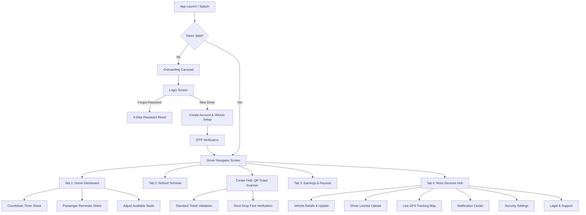

# 🚐 VINCY DRIVER App Documentation

<div className="hero--vincyuber" style={{background: 'linear-gradient(135deg, #1B5E20 0%, #23964D 45%, #2E7D32 100%)', color: 'white', padding: '3rem 2rem', borderRadius: '16px', textAlign: 'center', marginBottom: '2rem'}}>
  <h2 style={{color: 'white', fontSize: '2.2rem', marginBottom: '0.75rem'}}>🚐 Complete Driver UI/UX & Code Documentation</h2>
  <p style={{color: 'rgba(255,255,255,0.92)', fontSize: '1.15rem', maxWidth: '640px', margin: '0 auto'}}>
    All operational screens, passenger boarding verification flows, GPS tracking, and Flutter code for the VINCY DRIVER Minibus Platform
  </p>
</div>

## What is VINCY DRIVER?

**VINCY DRIVER** is the official driver-side transport and minibus operations application built with **Flutter 3.10+ / Dart** for public and private transit operators in Saint Vincent and the Grenadines. 

It empowers drivers to:
- ⏱️ Broadcast scheduled departure countdown timers to passengers in real-time.
- 📷 Scan passenger digital QR tickets and handle short-drop trip segments.
- 📍 Stream live GPS coordinates to passengers and transport dispatchers.
- 🔄 Process instant ticket returns and refund verifications on the go.
- 💰 Monitor daily/weekly earnings, trip counts, and request payouts via bank or mobile wallets.
- 📄 Manage vehicle registration, seating availability, and driving compliance credentials.

---

## 🎯 Core Driver Features

<div className="screen-grid" style={{display:'grid', gridTemplateColumns:'repeat(auto-fill, minmax(260px,1fr))', gap:'1.25rem', margin:'1.5rem 0'}}>

<div className="screen-card" style={{background:'white', borderRadius:'12px', padding:'1.25rem', boxShadow:'0 2px 12px rgba(0,0,0,0.08)', borderLeft:'4px solid #23964D'}}>
  <h3 style={{color:'#23964D', margin:'0 0 0.5rem'}}>⏱️ Departure Countdowns</h3>
  <p style={{margin:0, color:'#555', fontSize:'0.9rem'}}>Set customized countdown timers (5 to 60 mins) for assigned bus stops. Broadcasts departure alerts directly to waiting passengers.</p>
</div>

<div className="screen-card" style={{background:'white', borderRadius:'12px', padding:'1.25rem', boxShadow:'0 2px 12px rgba(0,0,0,0.08)', borderLeft:'4px solid #23964D'}}>
  <h3 style={{color:'#23964D', margin:'0 0 0.5rem'}}>📷 QR Boarding Scanner</h3>
  <p style={{margin:0, color:'#555', fontSize:'0.9rem'}}>High-speed camera scanner powered by <code>mobile_scanner</code> for instant validation of passenger tickets and short-drop segments.</p>
</div>

<div className="screen-card" style={{background:'white', borderRadius:'12px', padding:'1.25rem', boxShadow:'0 2px 12px rgba(0,0,0,0.08)', borderLeft:'4px solid #23964D'}}>
  <h3 style={{color:'#23964D', margin:'0 0 0.5rem'}}>📍 Live GPS Broadcasting</h3>
  <p style={{margin:0, color:'#555', fontSize:'0.9rem'}}>Background location streaming via <code>Geolocator</code> and <code>Socket.IO</code>, pinpointing vehicle position on passenger map interfaces.</p>
</div>

<div className="screen-card" style={{background:'white', borderRadius:'12px', padding:'1.25rem', boxShadow:'0 2px 12px rgba(0,0,0,0.08)', borderLeft:'4px solid #23964D'}}>
  <h3 style={{color:'#23964D', margin:'0 0 0.5rem'}}>🔄 Ticket Refund Terminal</h3>
  <p style={{margin:0, color:'#555', fontSize:'0.9rem'}}>Scan or input passenger barcodes to inspect eligibility, evaluate refundable balances, and process refunds directly from the vehicle.</p>
</div>

<div className="screen-card" style={{background:'white', borderRadius:'12px', padding:'1.25rem', boxShadow:'0 2px 12px rgba(0,0,0,0.08)', borderLeft:'4px solid #23964D'}}>
  <h3 style={{color:'#23964D', margin:'0 0 0.5rem'}}>💰 Earnings & Payouts</h3>
  <p style={{margin:0, color:'#555', fontSize:'0.9rem'}}>Real-time balance breakdown (XCD), completed trips count, withdraw request submission, and paginated transaction records.</p>
</div>

<div className="screen-card" style={{background:'white', borderRadius:'12px', padding:'1.25rem', boxShadow:'0 2px 12px rgba(0,0,0,0.08)', borderLeft:'4px solid #23964D'}}>
  <h3 style={{color:'#23964D', margin:'0 0 0.5rem'}}>🚗 Vehicle & Compliance</h3>
  <p style={{margin:0, color:'#555', fontSize:'0.9rem'}}>Vehicle specifications, route stop allocations, seating capacity controls, and driving license upload & verification.</p>
</div>

</div>

---

## 🎨 Brand & Design Guidelines

| Specification | Configuration | Description |
|---------------|---------------|-------------|
| **Application Title** | `VINCY DRIVER` | Official mobile client for licensed operators |
| **Platform** | Flutter `^3.10.3` / Android & iOS | Target SDK Android 34+, iOS 15+ |
| **Primary Brand Color** | `#23964D` (Vincy Green) | Accent, active navigation states, primary buttons |
| **Secondary Color** | `#A6A8AB` | Disabled borders, tertiary icons |
| **Background Color** | `#F8FAFC` | Clean modern background |
| **Dark Slate Text** | `#1A0E2A` | High-contrast readable typography |
| **Currency** | `XCD` (Eastern Caribbean Dollar) | Standard currency code across all balances |
| **Typography** | `PlusJakartaSans` | Modern, legible geometric sans-serif |

---

## 📱 Navigation Architecture

The app uses an **`IndexedStack`** bottom navigation container (`NavigatorScreen`) coupled with a **docked center Floating Action Button (FAB)** for fast ticket verification:

| Tab | Icon | Label | Controller & Screen | Core Purpose |
|:---:|:----:|:------|:-------------------|:-------------|
| **1** | 🏠 | **Home** | `HomeController` / `HomeScreen` | Scheduled countdowns, active trips, reminder broadcasting |
| **2** | 🔄 | **Refund** | `RefundController` / `RefundScreen` | Ticket scanning, refund verification & approval |
| **FAB** | 📷 | **QR Scanner** | `NavigatorController` / `ScannerBottomSheet` | Dual-mode camera scanner (Full Ticket vs Short Drop) |
| **3** | 💰 | **Earnings** | `EarningsController` / `EarningsScreen` | Revenue summary, payout request, transaction history |
| **4** | ⊞ | **More** | `MoreController` / `MoreScreen` | Vehicle profile, documents, tracking, security, legal |



---

## 🛠️ Tech Stack & Key Dependencies

| Technology / Library | Version | Purpose in Driver Application |
|----------------------|---------|------------------------------|
| **Flutter SDK** | `^3.10.3` | Cross-platform core framework |
| **GetX** | `^4.7.3` | Reactive state management, dependency injection & named routing |
| **Mobile Scanner** | `^6.0.4` | Hardware-accelerated barcode & QR code camera feed |
| **Google Maps Flutter**| `^2.17.1` | Interactive vector maps for vehicle route tracking |
| **Geolocator** | `^13.0.2` | High-precision background GPS location tracking |
| **Socket.IO Client** | `^3.1.6` | Real-time WebSocket channel for driver position broadcast |
| **Dio** | `^5.9.2` | Robust HTTP client with Bearer auth token interception |
| **Infinite Scroll Pagination** | `^5.1.1` | Lazy-loaded transaction history & departure feeds |
| **Pinput** | `^6.0.2` | Clean 4-digit PIN verification widget |
| **Flutter Secure Storage** | `^10.3.1` | Encrypted keychain/keystore token persistence |
| **Firebase Messaging** | `^16.4.1` | Background push notifications for booking alerts |

---

## 📁 Project Directory Structure

```
vincy-uber-driver-app/
├── lib/
│   ├── main.dart                          # Bootstrap, Firebase, LocationService & Theme
│   ├── core/                              # Global styles, endpoints, constants & routes
│   │   ├── app_constants.dart             # API paths, country code (+1784), currency (XCD)
│   │   ├── app_images.dart                # Icons and vector asset references
│   │   ├── app_routes.dart                # Centralized GetPage route declarations
│   │   ├── app_strings.dart               # Static text and labels
│   │   ├── app_style.dart                 # AppColors, AppTextStyle, dimensions
│   │   └── app_theme.dart                 # Material 3 light ThemeData definition
│   ├── components/                        # Reusable atomic widgets
│   │   ├── form/                          # TextInput, PasswordInput, SelectInput, ImageInput
│   │   └── widgets/                       # Button, AppBarWidget, SkeletonLoader, ScannerCamera
│   ├── helpers/                           # Formatting, validation & Paginate helper
│   ├── models/                            # JSON serializable data transfer objects
│   │   ├── auth/                          # UserModel, LoginResponse, Credentials
│   │   ├── earnings/                      # EarningsSummaryModel, TransactionModel
│   │   ├── ticket/                        # ScannedTicketModel, TicketDetailsModel
│   │   └── vehicle/                       # VehicleModel, BusStop, PositionModel
│   ├── screens/                           # Feature modules (View + Controller)
│   │   ├── splash/                        # App launch and auto-routing
│   │   ├── onboarding/                    # 3-step carousel introducing driver capabilities
│   │   ├── auth/                          # Login, Register, OTP, Forgot Password
│   │   ├── navigator/                     # 5-tab docked bottom nav container
│   │   │   ├── home/                      # Departures, countdown timers & reminder sheet
│   │   │   ├── refund/                    # Ticket refund terminal & verification
│   │   │   ├── scanner_bottom_sheet.dart  # Dual-mode camera QR ticket scanner
│   │   │   ├── earnings/                  # Financial cards, payout modal, transaction logs
│   │   │   └── more/                      # Service menus, profile summary & logout
│   │   ├── vehicle/                       # Vehicle specs & assigned route stops
│   │   ├── vehicle_update/                # Vehicle editing form
│   │   ├── documents/                     # Driving license front/back upload
│   │   ├── tracking/                      # Google Maps live driver position stream
│   │   ├── notification/                  # Notification center with mark-all-read
│   │   ├── security_settings/             # Password change and credentials
│   │   └── contact/                       # Help desk, phone and email support
│   └── services/                          # Singletons and network providers
│       ├── api_repo.dart                  # Dio HTTP repository for REST endpoints
│       ├── location_service.dart          # GPS Geolocator listener & location streaming
│       ├── socket_service.dart            # Socket.IO connection manager
│       ├── earnings_service.dart          # Reactive driver balance store
│       ├── profile_service.dart           # User profile & authentication state
│       └── notification_service.dart      # Firebase Messaging & local alerts
└── pubspec.yaml                           # Dependencies specification
```

---

## 💻 Key Architecture Implementations

### 1. App Entry Point (`lib/main.dart`)
Bootstraps Firebase, initializes the reactive `LocationService` singleton, locks orientation to portrait, and mounts `GetMaterialApp`:

```dart
void main() async {
  WidgetsFlutterBinding.ensureInitialized();
  try {
    await Firebase.initializeApp();
    await NotificationService.instance.initialize();
  } catch (e) {
    debugPrint('Firebase/Notification initialization failed: $e');
  }

  // Register and initialize global LocationService
  Get.put(LocationService.instance);
  await LocationService.instance.initialize();

  await SystemChrome.setPreferredOrientations([DeviceOrientation.portraitUp]);

  await ProfileService.instance.initialize();
  await SiteSettingsService.instance.initialize();
  runApp(const VincyUberDriverApp());
}
```

### 2. Docked Bottom Navigation with Center Scanner (`lib/screens/navigator/navigator_screen.dart`)
Integrates the `ScannerBottomSheet` inside a docked Floating Action Button:

```dart
bottomNavigationBar: isKeyboardOpen
    ? null
    : NavigationBottomNavBar(controller: controller),
floatingActionButton: isKeyboardOpen
    ? null
    : FloatingButtonWidget(
        heroTag: null,
        backgroundColor: AppColors.primary,
        icon: Img(
          src: AppImages.qrScan,
          color: AppColors.white,
          width: 24,
          height: 24,
        ),
        onTap: () {
          FocusManager.instance.primaryFocus?.unfocus();
          controller.isScanning = true;
          controller.barcodeController.clear();
          controller.selectedShortDrop = null;
          controller.update();
          ScannerBottomSheet.show(context: context);
        },
      ),
floatingActionButtonLocation: FloatingActionButtonLocation.centerDocked,
```

---

## 📋 Complete Documented Screens Directory

| # | Screen / Feature | Module | Primary Controller | Documentation Link |
|---|------------------|--------|--------------------|-------------------|
| 1 | **Splash & Onboarding** | Auth / Intro | `OnboardingController` | [View Docs](/onboarding) |
| 2 | **Login, Register & Setup** | Authentication | `LoginController`, `CreateAccountController` | [View Docs](/auth) |
| 3 | **Home Dashboard & Departures** | Core Ops | `HomeController` | [View Docs](/home) |
| 4 | **QR Scanner & Boarding** | Core Ops | `NavigatorController` | [View Docs](/qr-scanner) |
| 5 | **Refund Management** | Core Ops | `RefundController` | [View Docs](/refund) |
| 6 | **Earnings & Payouts** | Finance | `EarningsController` | [View Docs](/earnings) |
| 7 | **Vehicle Profile & Update** | Services | `VehicleController` | [View Docs](/vehicle) |
| 8 | **Driver Documents** | Compliance | `CreateVehicleController` | [View Docs](/documents) |
| 9 | **Live GPS Tracking** | Real-time | `TrackingController`, `LocationService` | [View Docs](/tracking) |
| 10 | **Notifications Center** | Alerts | `NotificationController` | [View Docs](/notifications) |
| 11 | **Security Settings** | Account | `SecuritySettingController` | [View Docs](/security-settings) |
| 12 | **Driver Profile** | Account | `ProfileService` | [View Docs](/profile) |
| 13 | **Legal, Policies & Support** | Support | Static / Web Views | [View Docs](/legal-support) |
