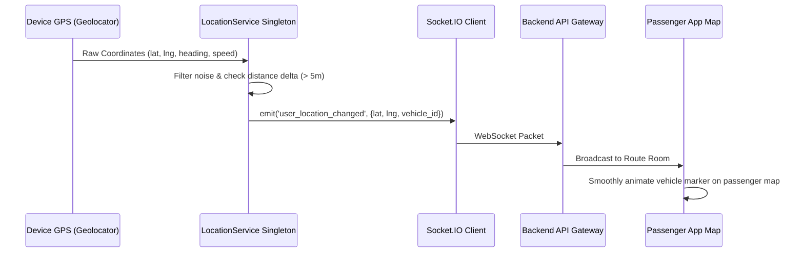

# 📍 Live GPS Tracking & Navigation

Real-time location awareness allows passengers to track oncoming minibuses and eliminates roadside guesswork. The **Tracking Module** coordinates high-accuracy GPS positioning, interactive Google Maps rendering, and real-time WebSocket coordinate broadcasting.

---

## 📱 Mobile Screen Interface

<div style={{display:'flex', gap:'2rem', alignItems:'flex-start', flexWrap:'wrap', margin:'1.5rem 0'}}>
<div style={{flex:'0 0 auto', textAlign:'center'}}>
  <div style={{background:'#1a1a1a', borderRadius:'28px', padding:'8px', display:'inline-block', boxShadow:'0 12px 36px rgba(0,0,0,0.2)'}}>
    
  </div>
  <div style={{marginTop:'0.5rem', background:'#E8F5E9', color:'#23964D', padding:'4px 12px', borderRadius:'20px', fontSize:'0.8rem', fontWeight:'600'}}>Live GPS Map</div>
</div>
<div style={{flex:'1', minWidth:'280px'}}>

### Tracking Capabilities

| Capability | Implementation | Purpose |
|------------|----------------|---------|
| **Interactive Map** | `google_maps_flutter` | Vector map with custom minibus icon marker |
| **GPS Stream** | `geolocator: ^13.0.2` | High-frequency position polling (every 5-10m) |
| **Socket Broadcast** | `socket_io_client: ^3.1.6` | Emits `user_location_changed` to connected passengers |
| **External Directions** | `url_launcher: ^6.3.2` | Deep-links to Google Maps turn-by-turn navigation |

</div>
</div>

---

## 🛰️ Real-Time Location Pipeline



---

## 💻 Controller Implementation (`TrackingController`)

```dart
class TrackingController extends GetxController {
  GoogleMapController? mapController;
  Position get driverPosition => LocationService.instance.driverPosition.value;
  VehicleModel get vehicle => LocationService.instance.vehicle.value;

  @override
  void onInit() {
    super.onInit();

    // Listen to real-time driver GPS updates
    LocationService.instance.driverPosition.listen((pos) {
      if (pos.lat != null && pos.lng != null && (pos.lat != 0.0 || pos.lng != 0.0)) {
        _animateCameraToPosition(pos.lat!, pos.lng!);
        update();
      }
    });

    // Listen to incoming socket events
    SocketService.instance.on('user_location_changed', _userLocationChanged);
  }

  void _animateCameraToPosition(double lat, double lng) {
    mapController?.animateCamera(
      CameraUpdate.newCameraPosition(
        CameraPosition(
          target: LatLng(lat, lng),
          zoom: 16.5,
          tilt: 35.0,
        ),
      ),
    );
  }
}
```

---

## 🎨 Complete Design Artboard

<div className="artboard-container">
  
  <div className="artboard-caption">
    <span>📐 Figma Reference: Live GPS Tracking Map & Help Desk Support Flow</span>
  </div>
</div>
